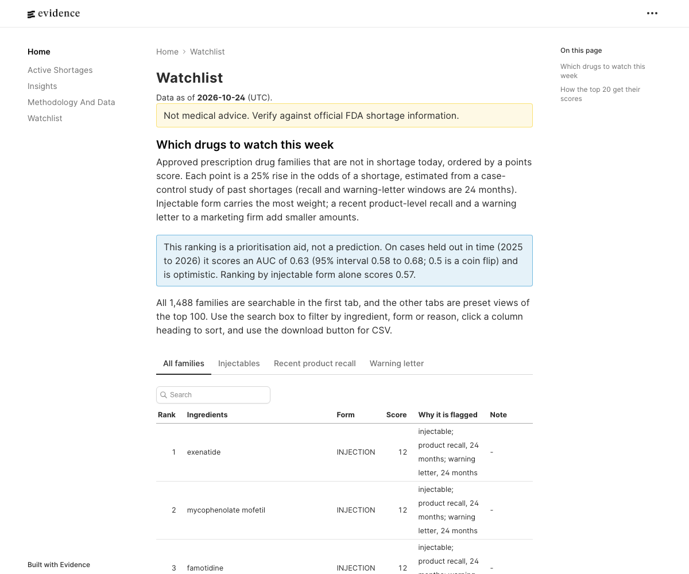
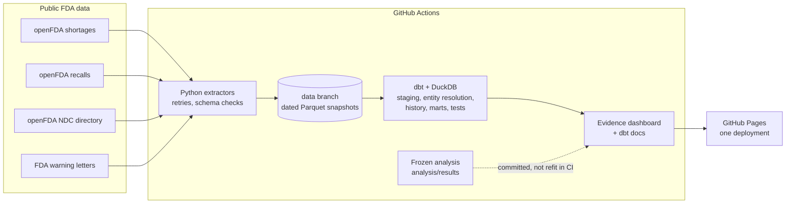

# ShortageWatch

A daily-refreshed monitor of US drug shortages that ranks approved prescription drugs by how closely they resemble drugs that went short before. It joins four public FDA datasets, tests which signals matter, and publishes a decision tool for hospital pharmacy procurement teams.

[](https://github.com/vaish725/shortagewatch/actions/workflows/ci.yml)
[](https://github.com/vaish725/shortagewatch/actions/workflows/daily_pipeline.yml)
[](https://github.com/vaish725/shortagewatch/tree/data)

**Live dashboard: https://vaish725.github.io/shortagewatch/** | [Data model docs](https://vaish725.github.io/shortagewatch/dbt-docs/) | [Write-up](docs/writeup.md) | [Analysis plan](docs/analysis_plan.md)



## The problem

Hospital pharmacies usually learn that a drug is short after it appears on the FDA list, by which point alternatives are being bought up. The warning signs (recalls, regulatory action against a manufacturer, how many firms make the drug) are public, but they sit in separate FDA datasets with no common key and inconsistent drug and firm names. ShortageWatch links them, measures which signals have actually gone with past shortages, and turns that into a weekly watchlist with the reason for every flag.

## What it found

From a case-control study of 285 shortage families, each compared with 5 drugs on the market and not short on the same date (conditional logistic regression; the plan was committed before any model was run, see [docs/analysis_plan.md](docs/analysis_plan.md)):

- **Injectable products have about 4.4 times the odds of shortage** (odds ratio 4.36, 95% interval 3.25 to 5.86).
- **A Class I or II recall of the same product in the prior 24 months goes with about 1.8 times the odds** (1.83, 1.22 to 2.76).
- **Among generics, having a single supplier was not associated with shortage**, contrary to the usual assumption (0.76, 0.43 to 1.35). Sole-source brand products had lower odds (0.44, 0.22 to 0.87). The pre-registered hypothesis was not supported, and adjusting for how many products a family has did not rescue it.
- **Active injectable shortages have been open a median of 1,319 days (about 3.6 years)**, against 239 days for other forms. The feed may have dropped long-resolved shortages, so this leans long.
- A warning letter to a marketing firm goes with higher odds (1.74, 1.18 to 2.56), but the effect disappears without the largest manufacturers, so it is reported as driven by large firms.

**Limits of the watchlist.** On shortages held out in time (2025 to 2026) the points score reaches an AUC of 0.63 (95% interval 0.58 to 0.68), a modest but measurable gain of 0.06 (0.03 to 0.08) over ranking by injectable form alone (0.57). It is optimistic, because supplier counts are measured today. It is a prioritization aid, not a prediction, and not medical advice.

## How it works



- **Ingestion** (`ingestion/`): Python extractors with retries, backoff and pydantic validation. Shortages are snapshotted daily and the NDC directory and warning letters weekly, as dated Parquet on the `data` branch, because the shortage feed has no history of its own. A failed run opens a GitHub issue; the site keeps its last good build.
- **Warehouse** (`warehouse/`): a dbt project on DuckDB with 29 models, 84 data tests and 4 unit tests. Type 2 history is rebuilt from the dated snapshots rather than with dbt snapshots, so it survives the warehouse being recreated on every run. Recalls, which carry no NDC field, are linked to products by NDC found in the recall text, then firm and product name, then ingredient name; the SQL matcher is tested against the Python original for exact parity.
- **Analysis** (`analysis/`): conditional logistic regression with sensitivity checks, Kaplan-Meier durations and a pseudo out-of-time validation. Results are committed to `analysis/results/` with the date and code commit, and CI does not refit them, so the numbers always match the committed plan. Live data (overview, active shortages, watchlist signals) refreshes daily; inference is frozen.
- **Dashboard** (`dashboard/`): an Evidence static site, built from pre-aggregated tables.

Match quality, at the time of the frozen analysis: 99% of shortage records link to a product family (88.9% by NDC, the rest by name and form); 94% of recalls in the analysis window are linked to a product or ingredient, 64% to a specific product. A hand-labelled sample put the ingredient-level recall match at 57% precise (95% interval 47% to 66%), so it is shown on the watchlist for information and never scored.

## Run it locally

```bash
make setup                 # virtual environment with Python and dbt dependencies (Python 3.12 or newer)
make ingest                # pull all four sources into data/raw/
make data-sync             # check out the snapshot history from the data branch
make match                 # reference recall matching in Python
make transform             # dbt build: models, tests, unit tests, parity test
make dashboard             # export tables and build the static site (needs Node 22)
make test                  # Python tests
```

Rebuild the frozen analysis deliberately with `make analysis` (it rebuilds the warehouse as of 2026-10-22, fits the models and rewrites `analysis/results/` and the watchlist weights). An optional `OPENFDA_API_KEY` raises the API rate limit.

## Repository layout

| Path | Contents |
|---|---|
| `ingestion/` | Extractors, schemas, HTTP client, NDC parsing, recall matching reference |
| `warehouse/` | dbt project: staging, intermediate, marts, seeds, tests |
| `analysis/` | Models, validation, duration, export; `results/` holds the frozen outputs |
| `dashboard/` | Evidence project |
| `docs/` | Analysis plan, data quality log, write-up |
| `.github/workflows/` | Daily pipeline, CI and the site deployment |

## Limitations

- Results are associations, not causes: a recall and a shortage can share one root cause such as a plant quality failure.
- Supplier structure is measured from today's NDC directory, so it can reflect a shortage rather than precede it. Weekly NDC snapshots started on 2026-10-22 will allow time-correct counts later.
- The FDA list defines shortages more narrowly than other trackers, and shortages that resolved long ago may have left the feed.
- Warning letters are only available from 2021-01 and the export may be incomplete.
- Only a handful of shortages have resolved since snapshots began, so duration estimates are descriptive.

## Data and license

Code is released under the [MIT License](LICENSE). Data comes from [openFDA](https://open.fda.gov/) and the FDA warning letters listing, which are public and provided under [FDA's terms](https://open.fda.gov/terms/). Do not rely on this project to make decisions about medical care; verify against official FDA shortage information.
